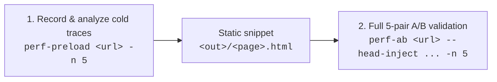
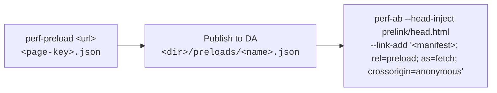

# perf-tools

Page-load performance measurement and optimization tools for `*.adobe.com` and `*--adobecom.aem.live` pages, usable from the command line, GitHub Actions, or as **GitHub Copilot agent skills**:

- **`perf-ab`** *(primary tool)* — Runs controlled before/after Lighthouse comparisons on a live production page (such as `www.adobe.com`). Compares the unmodified production page ("before") against your changes ("after"): **Milo or MAS pull requests** (`--milo-pr`, `--mas-pr`), an injected **`head.html` preload snippet** (`--head-inject`), or **both combined**.
- **`perf-preload`** — Records cold page loads via `perf-ab` (or analyzes existing DevTools traces), identifies every critical resource that finished loading before Largest Contentful Paint (LCP), and generates a static `<link rel="modulepreload|preload">` snippet ready to test with `perf-ab --head-inject`.
- **[Results UI (Public Dashboard)](https://adobecom.github.io/perf-tools/)** — Interactive, read-only web UI for browsing completed `perf-ab` runs, paired medians, per-pair charts, and PR provenance, with shareable deep links output automatically by the Copilot skills.

---

## Quick Start

### Prerequisites

- **Node.js 22.19+** (runs **Lighthouse 13.6.0**).
- **For GitHub Actions runs (default):** GitHub CLI (`gh`) authenticated with Actions write access to `adobecom/perf-tools` (or `--repo`).
- **For local runs (`--local`):** Google Chrome installed locally (or `CHROME_PATH` set).

### Install as a Copilot Plugin

In the **GitHub Copilot app**:
1. [Add the `adobecom/perf-tools` marketplace](https://github.com/copilot/app/launch?open=ghapp%3A%2F%2Fplugins%2Fmarketplace%2Fadd%3Fsource%3Dadobecom%252Fperf-tools).
2. [Install the `perf-tools` plugin](https://github.com/copilot/app/launch?open=ghapp%3A%2F%2Fplugins%2Finstall%3Fsource%3Dperf-tools%2540perf-tools).

In the **Copilot CLI**:

```sh
copilot plugin install adobecom/perf-tools
```

Once installed, you can ask Copilot in natural language:
- *"Test Milo PR 7062 on https://www.adobe.com/acrobat/plans.html"*
- *"Generate preloads for https://www.adobe.com/products/photoshop.html and A/B test them"*

### Use live development skills

To use the current local checkout instead of a cached plugin, disable the
`perf-tools` plugin in Copilot and link both skill directories into
`~/.copilot/skills`:

```sh
# Run from the perf-tools checkout. Move any existing skill directories or links
# out of ~/.copilot/skills first to avoid loading duplicate skills.
mkdir -p ~/.copilot/skills
for skill in perf-ab perf-preload; do
  test ! -e "$HOME/.copilot/skills/$skill" &&
    test ! -L "$HOME/.copilot/skills/$skill" &&
    ln -s "$PWD/skills/$skill" "$HOME/.copilot/skills/$skill"
done
```

These links read the working tree, including uncommitted edits; they do not fetch
GitHub updates. Start a new Copilot session after switching sources so previously
loaded skill instructions are not reused. Keep the checkout at the linked path.

---

## `perf-ab`: Before/After Performance Comparisons

`perf-ab` measures the real impact of **Milo/MAS pull requests**, **`<head>` preload links** and **`Link` response header preloads (prelinks)** directly on a live production page.

### Common Workflows

```sh
# 1. Test a Milo or MAS pull request against live production
perf-ab "https://www.adobe.com/acrobat/plans.html" --milo-pr 7062 -n 5
perf-ab "https://www.adobe.com/acrobat/plans.html" --milo-pr 7062 --mas-pr 1487 -n 5

# 2. Test an injected <head> preload snippet (5-pair campaign)
perf-ab "https://www.adobe.com/acrobat/plans.html" --head-inject ~/perf-ab-runs/plans/preloads/acrobat--plans.html -n 5 -o ~/perf-ab-runs/plans/ab-full

# 3. Combine preload links and a Milo/MAS PR in a single comparison
perf-ab "https://www.adobe.com/acrobat/plans.html" \
  --head-inject ~/perf-ab-runs/plans/preloads/acrobat--plans.html --milo-pr 7062 -n 5 -o ~/perf-ab-runs/plans/ab-milo

# 4. Run locally on your machine instead of GitHub Actions
perf-ab "https://www.adobe.com/acrobat/plans.html" --milo-pr 7062 -n 3 --local

# 5. Send a prelink (e.g. a preload manifest) in the after document's Link response header
perf-ab "https://www.adobe.com/acrobat/plans.html" \
  --link-add '</acrobat/preloads/plans.json>; rel=preload; as=fetch; crossorigin=anonymous' -n 5
```

### What You Can Compare

| Option | "Before" Variant | "After" Variant |
| --- | --- | --- |
| `--milo-pr <n>` / `--mas-pr <n>` | Unchanged live production page | Pinned PR diff served through the local measuring proxy (`libs/**` → `/libs/**` for `adobecom/milo`, `web-components/dist/**` → `/mas/libs/**` for `adobecom/mas`). Added, modified, removed, and renamed files are handled accurately; unmapped test/docs files are ignored. |
| `--head-inject <file>` | Unchanged live production page (with its existing `Link` header preloads) | Snippet injected into `<head>` before the first `<script>`, with all `rel=preload` and `rel=modulepreload` entries stripped from the document's `Link` response header so the snippet is the **sole source of preloads**. |
| `--head-inject` + `--milo-pr` / `--mas-pr` | Unchanged live production page | Applies both the `<head>` preload snippet and the pinned PR file changes together. |
| `--link-add` / `--link-remove` / `--link-replace` | Unchanged live production page (with its existing `Link` response header) | The document's `Link` response header with entries added, removed, or replaced by the measuring proxy (see [Editing `Link` header prelinks](#editing-link-header-prelinks)). Combines with every other option. |

### Editing `Link` Header Prelinks

The measuring proxy can rewrite the **`Link` response header of the "after" document**, so a prelink can be tested before it exists in production (for example, before the site's header config sends it). The "before" document is never touched.

```sh
# Add a prelink to a page (a page without a Link header gets it as its only entry)
perf-ab "https://www.adobe.com/acrobat/plans.html" \
  --link-add '</acrobat/preloads/plans.json>; rel=preload; as=fetch; crossorigin=anonymous' -n 5

# Remove one production preload and change another one
perf-ab "https://www.adobe.com/acrobat/plans.html" \
  --link-remove /libs/martech/martech.js \
  --link-replace '</libs/utils/utils.js>; rel=modulepreload' -n 5

# Replace every production preload with your own set ("*" = every rel=preload / rel=modulepreload entry)
perf-ab "https://www.adobe.com/acrobat/plans.html" \
  --link-remove '*' \
  --link-add '</libs/utils/utils.js>; rel=preload; as=script; crossorigin=anonymous' \
  --link-add '</acrobat/preloads/plans.json>; rel=preload; as=fetch; crossorigin=anonymous' -n 5
```

| Flag (repeatable) | Value | Effect on the "after" `Link` header |
| --- | --- | --- |
| `--link-remove <url\|*>` | A root-relative path or `https://` URL, or `*` (quote it in the shell) | Removes every entry for that URL; `*` removes every `rel=preload` / `rel=modulepreload` entry and keeps the rest (`preconnect`, `canonical`, ...). |
| `--link-replace <entry>` | One full entry, e.g. `'</libs/utils/utils.js>; rel=modulepreload'` | Replaces, in place, the one entry with the same URL (to change `rel`, `as`, `crossorigin`, `fetchpriority`, ...). |
| `--link-add <entry>` | One full entry, e.g. `'</x.json>; rel=preload; as=fetch; crossorigin=anonymous'` | Appends the entry at the end of the header. |

- **Order:** remove, then replace, then add. With `--head-inject`, the production `rel=preload` / `rel=modulepreload` entries are unset first, so the snippet plus your added entries are the only preloads (useful to test an inline head script together with the prelink of the manifest it reads).
- **Matching by URL:** entries are matched by their target URL resolved against the page URL, so `</libs/utils/utils.js>` and `<https://www.adobe.com/libs/utils/utils.js>` are the same entry.
- **Guarded, like `--patch`:** a removed URL must be in the header, a replaced URL must be in it exactly once with a different value, and an added URL must not be in it yet (use `--link-replace`). Otherwise production changed and the job fails instead of measuring something else.
- **Validation before dispatch:** every entry is a single line of at most 2048 characters (no header injection), `--link-add` / `--link-replace` entries need a `rel`, targets are root-relative paths or `https://` URLs without credentials, a URL may not be both removed and replaced or both replaced and added, and at most 100 edits are allowed. `--link-remove '*'` is rejected with `--head-inject` (it already unsets those entries).
- **Prelink fetches:** an `as=fetch` prelink is only reused by a script's `fetch()` when request mode and credentials match. Plain `fetch(url)` (CORS mode, `same-origin` credentials) matches `crossorigin=anonymous`; without it the browser downloads the file twice.
- **Reported:** `results.json` → `linkHeader` lists the requested `edits`, the `production` header, the `served` header, and the `removed`, `replaced` (`from` / `to`) and `added` entries; each "after" `run.json` has the same `linkHeader` record. The console prints them, and the Results UI shows a **Link header edits** change badge (the entries themselves stay in the artifact).
- **Experiment configs:** use `after.linkHeader` with the same lists, e.g. `"linkHeader": { "remove": ["*"], "add": ["</acrobat/preloads/plans.json>; rel=preload; as=fetch; crossorigin=anonymous"] }`.

### Where Measurements Run

| Mode | How It Works | When to Use |
| --- | --- | --- |
| **GitHub Actions** *(default)* | Dispatches `.github/workflows/perf-ab.yml` via `gh`, fans out `-n` parallel matrix jobs (one before/after pair per runner VM), verifies **US egress** (`Server-Timing: geo;desc=US` + external geo checks, failing closed if non-US), and downloads the combined artifact. Can also be triggered manually from **Actions → perf-ab → Run workflow** with a `url`, `milo_pr` / `mas_pr`, and `runs`. | Standard for shareable, comparable numbers and PR sign-off. |
| **Local** (`--local`) | Runs the exact same Lighthouse 13.6.0 profile, measuring proxy, and cold-run policy on your machine using local Chrome, running pairs sequentially. Authenticates GitHub API PR reads via `GITHUB_TOKEN`, `GH_TOKEN`, or `gh auth token`. | Fast local iteration when explicitly requested. Marked `where: "local"` with a `local-results-not-comparable` warning. |

### Understanding Output & Results

By default, results are written to `./traces` relative to the current directory (override with `-o <dir>`). Any prior results in the target directory are cleaned before writing. Keep runs outside the repository checkout (for example `~/perf-ab-runs/<date>-<topic>/<campaign>`): a campaign is 300 MB or more of reports and traces.

- **Metrics reported:** Lighthouse Performance score (`0–100`), **FCP**, **LCP**, **Speed Index (SI)**, **TBT** (in ms), and **CLS**.
  - A run is accepted only when Lighthouse completes without runtime error and `FCP`, `LCP`, `SI`, and `CLS` are finite numbers (`performance` and `TBT` are included whenever the page reaches network quiet). Failed runs are never silently retried.
- **Directory layout:**
  - `results.json` — Aggregate summary: `status` (`ok` / `partial` / `failed`), `samples`, `medians` (`before`, `after`, and `delta` = **median of the per-pair deltas** across complete pairs), `pairs[]` (per-pair metrics, delta, runner info, Chrome version, and per-variant CPU `benchmarkIndexes`), `warnings[]`, `profile` / `profileKey`, `egress`, `hints`, and `linkHeader` (`Link` header edits, when requested).
  - `pair<i>/results.json` — Diagnostic metadata and per-run metrics for pair `i`.
  - `pair<i>/<variant><i>/` — Official Lighthouse `report.html` and `report.json`, Chrome `trace.json`, `devtoolslog.json`, and `run.json` (first document status, document geo, pinned PR provenance, and proxy request log with original vs. served compressed byte sizes).
  - `pair<i>/rejected/` — Preserved artifacts from any rejected run attempts for debugging.

---

## Results UI & Deep Links

Browse all published `perf-ab` measurements at **<https://adobecom.github.io/perf-tools/>**.

### What the UI Shows

- **Verdict & Medians:** Before/after medians and the **median of per-pair deltas** across complete pairs, with noise-aware status badges (filtering out normal mobile variance inside `±3` Perf score, `±100 ms` FCP/LCP/SI, `±50 ms` TBT, and `±0.01` CLS).
- **Per-Pair Breakdown & Charts:** Individual pair metrics (`before`, `after`, `delta`), visual comparison charts, Chrome version, and per-variant Lighthouse CPU `benchmarkIndexes` for each runner VM.
- **Change Provenance & Diagnostics:** Pinned `adobecom/milo` and `adobecom/mas` PR commits (`baseSha`, `headSha`, `mergeBaseSha`) and mapped files, preload hint usage (`requested`, `used`, `contextual`, `dropped`), and warnings (`environment-variability`, `production-source-drift`).
- **Artifacts & Workflow Links:** Direct links to the GitHub Actions workflow run, commit SHA, and the downloadable 90-day artifact ZIP (with live expiration status).

### Deep Links & Copilot Skill Output

Every GitHub Actions run published from `main` has a permanent deep link built from its workflow run ID and attempt (`results.github.runId` and `results.github.runAttempt`):

```txt
https://adobecom.github.io/perf-tools/?run=<runId>-<attempt>
```

For example: <https://adobecom.github.io/perf-tools/?run=41631057972-1>

- **Automatic deep links from skills:** When you run a comparison or preload validation through the **`perf-ab`** or **`perf-preload`** Copilot skills, the skill automatically outputs the direct **UI deep link** (`https://adobecom.github.io/perf-tools/?run=<runId>-<attempt>`) for the run(s) it just executed alongside the GitHub Actions run URL and metric summary.
- **Filterable URLs:** You can also link directly to filtered views using query parameters:
  - `?q=<text>` — filter by page URL or run ID
  - `?status=ok|partial|failed` — filter by run completion status
  - `?profile=<profileKey>` — filter by Lighthouse profile key
  - `?from=YYYY-MM-DD&to=YYYY-MM-DD` — filter by date range

### How Runs Are Published (`perf-ab Pages`)

- **Automatic publishing:** When a `perf-ab` workflow run completes on `main`, `.github/workflows/pages.yml` (`perf-ab Pages`) automatically extracts whitelisted summary metrics into `site/data/index.json` and `site/data/runs/<runId>-<attempt>.json` and deploys the static site to GitHub Pages. Raw Lighthouse HTML reports and traces remain in the GitHub Actions artifacts rather than git history.
- **Backfilling runs:** Manually trigger **Actions → perf-ab Pages → Run workflow** on `main`. Leave `run_ids` empty to sweep all eligible completed runs, or pass comma-separated workflow run IDs to import specific runs.
- **Resetting published history:** Set `site/data/history-policy.json` to `{"schema":"perf-ab/history-policy-v1","cutoff":"<UTC ISO timestamp>"}`, clear `runs` in `site/data/index.json`, and remove the old per-run JSON files. Runs created at or before `cutoff` are excluded from sweeps and manual imports.

---

## Combining `perf-preload` + `perf-ab`

`perf-preload` and `perf-ab` are designed to work as a two-step loop: **discover** the critical LCP path with `perf-preload`, then **verify** the gain with `perf-ab --head-inject` (optionally alongside `--milo-pr` or `--mas-pr`).



### Step 1: Generate the LCP preload snippet

```sh
perf-preload "https://www.adobe.com/products/photoshop.html" -n 5 -o ~/perf-ab-runs/photoshop/preloads
```

This records 5 cold Lighthouse loads via `perf-ab`, finds the LCP candidate in each trace, and writes `~/perf-ab-runs/photoshop/preloads/products--photoshop.html`:

```html
<link rel="modulepreload" href="/creativecloud/scripts/utils.js">
<link rel="modulepreload" href="/libs/blocks/hero-marquee/hero-marquee.js">
<link rel="preload" href="//www.adobe.com/libs/blocks/hero-marquee/hero-marquee.css" as="style">
<link rel="modulepreload" href="/libs/features/placeholders.js">
```

### Step 2: Validate the snippet with `perf-ab`

```sh
# Full 5-pair parallel comparison (or combine with --milo-pr / --mas-pr)
perf-ab "https://www.adobe.com/products/photoshop.html" \
  --head-inject ~/perf-ab-runs/photoshop/preloads/products--photoshop.html -n 5 -o ~/perf-ab-runs/photoshop/ab-full
```

The Copilot skills run the requested count directly, using five pairs when no
count is specified. They do not add a preliminary smoke run unless requested;
reports are inspected after the campaign.

### Why They Work Together

- **Single source of preloads in "after":** When `--head-inject` is active, `perf-ab` strips all `rel=preload` and `rel=modulepreload` entries from the "after" document's HTTP `Link` response header (leaving `preconnect`, `canonical`, etc. untouched). Meanwhile, `perf-preload` includes resources currently preloaded by the `Link` header (marked `^` in its console table). This ensures you are comparing **production headers + HTML ("before")** against **your snippet alone ("after")**.
- **Automatic geo/locale hint resolution:** If a preload URL in your snippet contains contextual query parameters (`country`, `locale`, `lang`, `geo`, `region`, `market` — e.g. `/mas/io/fragment?...&country=CH`), `perf-ab` automatically rewrites that hint against the URL observed during the job's first baseline load. Unmatched contextual hints and `/experienceedge` URLs are dropped and reported under `results.json` → `hints`.
- **Post-run verification:** Check `results.json` → `hints` (`usedLinks`, `contextual`, `dropped`, `linkHeaderStripped`) and verify in the "after" Lighthouse report (`network-requests`) that each preloaded asset starts immediately after the document and downloads only once.

### Prelink Manifests: Preloads Without Editing the Page

Instead of a static snippet per page, a page can get its preloads from a **prelink manifest**: the `<page-key>.json` that `perf-preload` writes, published next to the page, sent early with a `Link` response header prelink, and turned into `<link>` tags by one shared inline script, [`prelink/head.html`](prelink/head.html).



```sh
# 1. Generate the snippet and the manifest from the page itself (aem.live pages keep their aem.live Milo URLs)
perf-preload "https://main--da-dc--adobecom.aem.live/drafts/ilyas/acrobat/plans" -n 5 --no-lcp-image -o ~/perf-ab-runs/drafts-plans/preloads

# 2. Publish ~/perf-ab-runs/drafts-plans/preloads/drafts--ilyas--acrobat--plans.json as /drafts/ilyas/acrobat/preloads/plans.json
#    (the perf-preload Copilot skill does this through the DA MCP, after your approval)

# 3. Measure: inline script + manifest prelink vs the unchanged page
perf-ab "https://main--da-dc--adobecom.aem.live/drafts/ilyas/acrobat/plans" \
  --head-inject prelink/head.html \
  --link-add '</drafts/ilyas/acrobat/preloads/plans.json>; rel=preload; as=fetch; crossorigin=anonymous' \
  -n 5 -o ~/perf-ab-runs/drafts-plans/ab-manifest
```

How `prelink/head.html` behaves:

- It derives the manifest URL from the page path (`<dir>/<name>` or `<dir>/<name>.html` → `<dir>/preloads/<name>.json`, `<dir>/` → `<dir>/preloads/index.json`) and requests it with a plain `fetch()`, which reuses the `Link` header prelink (one download).
- For each row it adds a `<link>` to `<head>` only when `rel` is `preload` (with `as` = `script`, `style`, `font`, `image` or `fetch`) or `modulepreload`, the URL is `https:` on the page host, `*.adobe.com`, `*--adobecom.aem.live` or `use.typekit.net` / `p.typekit.net`, and no `<link>` with that URL exists yet. `crossorigin` is only `anonymous`; `fetchpriority` only `high`, `low` or `auto`. Style preloads get a protocol-relative `href` (`//host/path`) whatever the row says, so site loaders that look up `link[href="<stylesheet URL>"]` still add the stylesheet.
- A missing (404) or invalid manifest, or any error, leaves the page unchanged; the script never throws. Without a prelink, the manifest request starts only when the script runs, so it costs one extra request (a 404 on pages without a manifest).
- With `--head-inject`, perf-ab unsets the production header preloads, so the manifest links (plus the added prelink) are the only preloads, as with a static snippet.

---

## `perf-preload`: LCP Preload Generator Details

You can run `perf-preload` against a live URL (which records traces via `perf-ab`) or point it at existing DevTools traces:

```sh
# Record 5 cold loads on GitHub Actions (default) or locally (--local)
perf-preload "https://www.adobe.com/products/photoshop.html" -n 5 -o ~/perf-ab-runs/photoshop/preloads
perf-preload "https://www.adobe.com/products/photoshop.html" -n 5 -o ~/perf-ab-runs/photoshop/preloads --local

# Or generate preloads from existing trace files or a perf-ab output directory
perf-preload --from ~/perf-ab-runs/photoshop/ab-full -o ~/perf-ab-runs/photoshop/preloads
perf-preload --from Trace-1.json --from Trace-2.json -o ~/perf-ab-runs/photoshop/preloads
```

### How Resources Are Selected & Formatted

- **Included resource types:** Scripts (`modulepreload` for ES modules, `as="script"` otherwise), stylesheets (`as="style"`), fonts (`as="font" crossorigin`), the LCP image (`as="image" fetchpriority="high"`, unless `--no-lcp-image` is passed), and GET JSON/HTML `fetch()` or XHR data requests (`as="fetch" crossorigin`) that finished before LCP in at least `--min-runs` traces (default: majority, e.g. 2 of 3 or 3 of 5).
- **`fetchpriority` (generic, every page):** all links start together and compete for bandwidth, so the files needed first get it: data fetches (JSON/HTML, small and awaited before rendering) are `high`; scripts first requested in the first half of the median time to LCP are `high`, later ones `low`; stylesheets and fonts keep the browser default (already the highest); the LCP image is `high`. The console table shows `[high]` / `[low]` per link.
- **Skipped automatically:** Resources already discovered by the HTML parser from the initial markup, POST/beacon requests, and cross-site origins (unless `--all-origins` is passed; same-site origins and `*.typekit.net` are kept by default).
- **Built-in exclusions (always active):**
  - `/experienceedge` and `/experienceedge/*`
  - `/marketingtech/*` (on any origin)
  - `bfp.adobe.com` (and its subdomains)
  - `/libs/features/mep/mep-next/*`: Milo MEP preview tooling (overlay, sidekick auth, MAS/CaaS inspectors). It loads on preview hosts such as aem.live, never for visitors, so traces recorded there would otherwise preload it.
  - Anything first requested by an excluded resource (for example `merch.js` imported by `mep-next.js`) is excluded too and listed as `requested by excluded <url>`.
  - Add custom exclusions with repeatable `--exclude <path-prefix|host>` (e.g. `--exclude /libs/martech --exclude cdn.example.net`). All matched requests are listed transparently under `Excluded by rule`. Requests that failed (HTTP 4xx/5xx or a network error, e.g. a `Link` header preload that 404s on an aem.live host) finish early but serve nothing, so they are never preloaded; they are listed under `Failed responses`.
- **Markup safety:**
  - Stylesheet preloads always use **protocol-relative URLs** (`//host/path`) without `crossorigin`. Site loaders such as Acrobat's `loadLink` skip a stylesheet when any `link[href="<the URL they load>"]` exists, whatever its `rel`; they load by path on www.adobe.com (`/libs/...`) but by absolute URL on aem.live (`https://main--milo--adobecom.aem.live/libs/...`). `//host/path` resolves to the same URL, so the no-CORS stylesheet fetch reuses the preload, but never equals either string (an absolute preload on aem.live left the page unstyled and hidden).
  - Data preloads (`as="fetch" crossorigin`) assume standard CORS `fetch()`/XHR with default credentials; review and remove any link whose consumer sends custom headers or `credentials: 'include'`.
  - Contextual URLs (marked `!` in console output) should only be served to matching locales/geos, never hardcoded globally in a shared `head.html`.

### Outputs: Snippet and Prelink Manifest

Each run writes two files to `-o <dir>` (the page key is the page path with `/` → `--`, e.g. `drafts--ilyas--acrobat--plans`):

- **`<page-key>.html`** — the static `<link>` snippet for `perf-ab --head-inject`.
- **`<page-key>.json`** — the same links as a **prelink manifest**: a DA sheet (`:type: "sheet"`) whose rows have exactly the columns `rel`, `href`, `as`, `crossorigin`, `fetchpriority` (strings, `""` when unset; `crossorigin` is `anonymous` or `""`). The page's own files are root-relative, stylesheets included, so one manifest works on every host that serves the page (for example an aem.live branch); the loader gives stylesheets their `//host/path` form. Country/locale specific URLs are left out (the manifest is served to every visitor) and counted in the console.

The console also prints where to publish it and the matching prelink: a page `<dir>/<name>` (or `<dir>/<name>.html`) gets `<dir>/preloads/<name>.json` on the page's own origin (`<dir>/` → `<dir>/preloads/index.json`), prelinked with `</dir/preloads/<name>.json>; rel=preload; as=fetch; crossorigin=anonymous`.

```json
{
  "total": 2, "limit": 2, "offset": 0, ":sheetname": "data", ":type": "sheet",
  "data": [
    { "rel": "modulepreload", "href": "https://main--milo--adobecom.aem.live/libs/utils/utils.js", "as": "", "crossorigin": "anonymous", "fetchpriority": "high" },
    { "rel": "preload", "href": "/dc-shared/placeholders.json", "as": "fetch", "crossorigin": "anonymous", "fetchpriority": "high" }
  ]
}
```

---

## How Measurement Works Under the Hood

Every design choice in `perf-ab` is aimed at eliminating measurement bias between "before" and "after":

1. **Real Lighthouse 13.6.0 Mobile + DevTools Throttling**
   - Emulates a Moto G Power (`412x823` @ `1.75x` DPR) with `throttlingMethod: "devtools"` — Chrome itself throttles the network (**Slow 4G**: `562.5 ms` request latency, `1474.56 kb/s` down, `675 kb/s` up) and CPU (**`4x` slowdown**).
   - Because throttling happens inside Chrome rather than via post-hoc Lantern simulation, the trace timestamps, network waterfall, and Lighthouse audits all describe the exact same throttled page load.
   - `profileKey` (e.g. `lh13.6.0-mobile-devtools-rtt150-tput1638.4-lat562.5-down1474.56-up675-cpu4-412x823@1.75-mobile`) locks the full preset so runs with different profiles are never mixed.
2. **Paired Matrix & Cold-Run Policy**
   - `-n N` dispatches `N` parallel GitHub Actions jobs. Each job measures **one complete pair** on the **same runner VM**. Odd pair indexes run `before` then `after`; even indexes reverse the order. The same schedule applies locally. Even pair counts balance first/second position exactly; odd counts differ by one. This reduces order bias but does not eliminate changing CPU availability.
   - Country/locale-specific preload hints must resolve against the measured baseline's requests, so those campaigns remain baseline-first and emit `fixed-order-contextual-hints` (no additional discovery loads). Static preload bursts are counterbalanced normally. Auto interactions discover targets in the first variant and replay the exact targets in the second.
   - Actual execution order and the ordering policy are recorded in `pairs[].job.order` / `.orderPolicy`, per-load `run.json`, and the Results UI.
   - If the Lighthouse CPU benchmark index (`benchmarkIndexes.before` / `.after`) varies by `1.2x` or more within a pair or across jobs, `results.json` surfaces an `environment-variability` warning instead of silently dropping slow runs.
   - **Every load is cold:** fresh Chrome process, empty temporary user profile, fresh proxy instance, and zero warm-up runs. Runs whose initial document came from cache are rejected.
3. **Realistic HTTP/2 Measuring Proxy**
   - "After" modifications are applied by a per-run local proxy that terminates TLS only for the measured host (using a single-run certificate trusted via Chrome's SPKI flag), preserves HTTP/2, and tunnels all other origins untouched.
   - Unmodified responses are forwarded byte-for-byte with original compression; modified responses are re-compressed with **Brotli quality 6** (matching production CDN transfer sizes). Ephemeral keys never touch the artifact directory.

---

## CLI Reference

### `perf-ab`

```txt
perf-ab <pageUrl> [options]
```

| Flag | Default | Description |
| --- | --- | --- |
| `-n, --runs <1..10>` | `3` | Number of cold before/after pairs. Copilot skills explicitly pass the requested count, or `-n 5` when unspecified. |
| `-o, --out <dir>` | `./traces` | Output directory for `results.json`, per-pair Lighthouse reports, and traces. |
| `--milo-pr <number>` | — | Serve mapped files (`libs/**` → `/libs/**`) from an `adobecom/milo` PR in the "after" variant. |
| `--mas-pr <number>` | — | Serve mapped files (`web-components/dist/**` → `/mas/libs/**`) from an `adobecom/mas` PR in the "after" variant. |
| `--head-inject <file>` | — | Inject HTML preload snippet into `<head>` before the first `<script>` and strip `Link` preload headers in "after". |
| `--link-add <entry>` | — | Repeatable. Append a `Link` entry (e.g. a prelink) to the "after" document's `Link` response header. |
| `--link-remove <url\|*>` | — | Repeatable. Remove the "after" `Link` entries for a URL; `*` removes every `rel=preload` / `rel=modulepreload` entry. |
| `--link-replace <entry>` | — | Repeatable. Replace the one "after" `Link` entry with the same URL. |
| `--local` | `false` | Run locally with Chrome on this machine instead of dispatching GitHub Actions. |
| `--repo <owner/name>` | `adobecom/perf-tools` | GitHub repository hosting the `perf-ab` workflow. |
| `--ref <branch>` | `main` | Git branch ref for the workflow. |
| `--timeout <minutes>` | `75` | Maximum wait time for the GitHub Actions run. |

### `perf-preload`

```txt
perf-preload <pageUrl> [options]
perf-preload --from <trace.json|dir> [--from ...] [options]
```

| Flag | Default | Description |
| --- | --- | --- |
| `-n, --runs <n>` | `3` | Number of cold loads to record through `perf-ab`. |
| `-o, --out <dir>` | `./preloads` | Output directory for `<page-key>.html` (snippet), `<page-key>.json` (prelink manifest) and recorded traces. |
| `--from <path>` | — | Repeatable. Analyze existing trace file(s) or a `perf-ab` output directory instead of recording. |
| `--min-runs <k>` | Majority (`⌊n/2⌋ + 1`) | Minimum number of traces a resource must finish before LCP in to be included. |
| `--no-lcp-image` | `false` | Omit the LCP image preload tag (useful when generating viewport-independent snippets). |
| `--all-origins` | `false` | Include resources from all third-party origins (default keeps same-site + `*.typekit.net`). |
| `--exclude <rule>` | — | Repeatable. Exclude a path prefix (e.g. `/libs/martech`) or host (e.g. `cdn.example.net`). |
| `--local` | `false` | Record traces locally via `perf-ab --local` instead of GitHub Actions. |

---

## Security, Target Scope & Development

- **Allowed targets (`lib/target.mjs`):** Measured URLs (including redirect hops) must use `https://` on a subdomain of `adobe.com` (e.g. `www.adobe.com`) or on an adobecom Edge Delivery Services live host `<ref>--<repo>--adobecom.aem.live` (e.g. `main--da-dc--adobecom.aem.live`; other owners, `aem.page` and lookalike hosts are refused), and must resolve exclusively to public IP addresses. Private, loopback, and reserved IP ranges are blocked both pre-flight and at connection time.
- **aem.live pages:** Milo loads from `main--milo--adobecom.aem.live/libs` there, not from the page host, so `--milo-pr` / `--mas-pr` (which serve PR files under the page host's `/libs/**` and `/mas/libs/**`) do not reach those requests; test Milo branches with `-b main -a <branch>` (`?milolibs=`) instead. `perf-preload` treats every `*--adobecom.aem.live` host as the page's own site, so the generated links keep those Milo URLs.
- **Public repository warning:** `adobecom/perf-tools` is public. Workflow inputs, logs, and artifacts (reports, traces, `results.json`) are readable by any signed-in GitHub user. Never pass credentials or tokens in URLs or `--head-inject` snippets — spec validation rejects URLs containing userinfo or secret-like query parameters (`token`, `api_key`, `secret`, `password`, `sig`, etc.) before dispatch.
- **Running tests:**
  ```sh
  npm test
  ```
  End-to-end Lighthouse tests run against a local HTTP/2 fixture (skipped if Chrome is unavailable); dashboard UI tests use Playwright Chromium.
- **Releasing:** Bump `version` in `package.json`, `plugin.json`, and `.claude-plugin/plugin.json` together.

## License

Apache-2.0, see [LICENSE](LICENSE).
